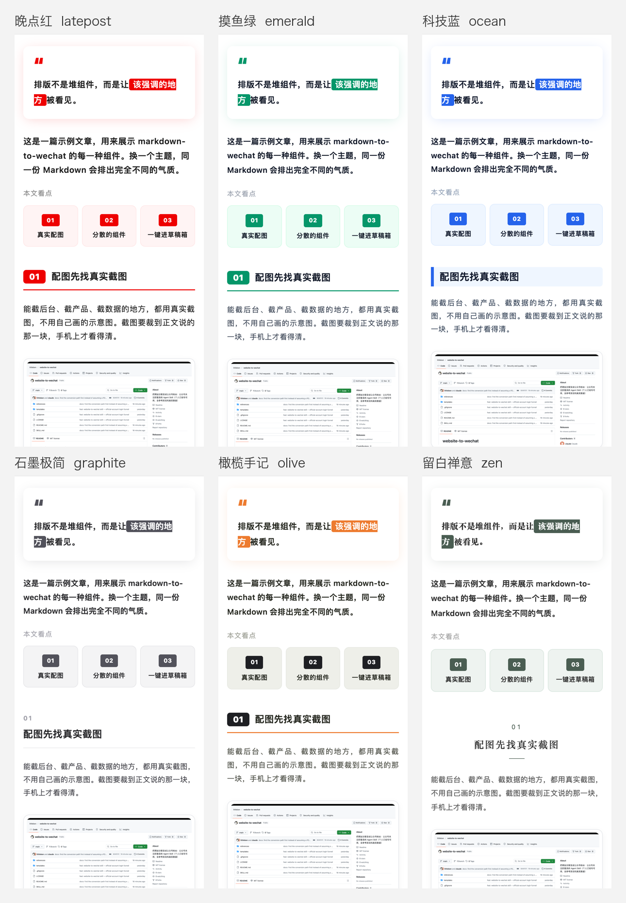

# markdown-to-wechat

公众号文章的**配图、排版、发布**一条龙 Agent Skill。写 Markdown，一条命令进公众号草稿箱。

- 📖 介绍文章：[benx.ai/blog/posts/markdown-to-wechat-skill](https://benx.ai/blog/posts/markdown-to-wechat-skill/)
- 👤 作者：[Ben](https://benx.ai)，公众号「AI工具进化论」



## 能做什么

- **排版**：6 套主题 × 12 种组件，包括引言卡、本文看点、编号章节、数据卡片、时间线、表格、胶囊列表、金句、提示条、踩坑提示、灰色旁注和 END 线。输出纯内联样式的 HTML，粘贴或用接口发布都不丢样式。
- **密度检查**：组件都可以用，但不能堆在一起。加粗、下划线、高亮超量，或者两个卡片紧挨着，都会提示。这套标准来自一篇真实文章的四轮修改。
- **配图**：截真实页面，2 倍清晰度，可以连已登录的 Chrome 截后台；还能生成 2.35:1 封面。
- **发布**：自动压图（JPEG，宽 ≤1080，≤1 MB）、上传正文图和封面、新建草稿。支持通过 IP 白名单服务器发布，凭据不落盘。
- **模板**：复盘、教程、工具盘点、观点、产品发布，5 种文章骨架。

## 安装

Claude Code：

```sh
git clone https://github.com/littleben/markdown-to-wechat ~/.claude/skills/markdown-to-wechat
pip install pillow requests playwright
```

Codex 和其他支持 Agent Skills 的工具：把仓库放进对应的 skills 目录即可。

然后对 Agent 说：

> 用 markdown-to-wechat，把这篇 Markdown 排成公众号文章，先截真实的后台数据做配图，预览没问题后发到草稿箱。

## 不用 Agent 也能用

```sh
cp templates/review.md my-article.md          # 从模板开始写
python3 scripts/cover.py cover.png --title "标题" --lines "副标题"
python3 scripts/preview.py my-article.md --shots shots/   # 手机宽度预览
python3 scripts/publish.py my-article.md --dry-run
WECHAT_APP_ID=wx... WECHAT_APP_SECRET=... python3 scripts/publish.py my-article.md
```

## 目录

```
SKILL.md                     Agent 读这个
references/
  markup.md                  Markdown 写法速查（所有组件）
  layout-standard.md         排版标准：用量和密度规则
  images.md                  配图：真实截图、封面、格式
  publish.md                 发布：白名单、凭据、错误码
templates/                   5 种文章骨架
scripts/
  render.py                  Markdown → 公众号 HTML（6 套主题）+ 密度检查
  validate.py                公众号 HTML 合规校验（来自 gzh-design）
  preview.py                 手机宽度预览 + 一键复制 + 截图
  shot.py                    2 倍截图（公开页面 / 已登录的 Chrome）
  cover.py                   2.35:1 封面
  publish.py                 渲染 → 校验 → 压图 → 上传 → 建草稿
  wechat_api.py              草稿接口（本机或白名单服务器上运行）
examples/sample.md           示例文章
```

## 主题

| 标识 | 名字 | 适合 |
|---|---|---|
| latepost | 晚点红 | 复盘、深度、观点 |
| emerald | 摸鱼绿 | 教程、测评、清单 |
| ocean | 科技蓝 | 工具盘点、技术 |
| graphite | 石墨极简 | 设计、专业观点 |
| olive | 橄榄手记 | 案例、产品发布 |
| zen | 留白禅意 | 随笔、生活 |

## 致谢与许可

组件设计和 `scripts/validate.py` 来自 [gzh-design](https://github.com/isjiamu/gzh-design-skill)（甲木 × 摸鱼小李，AGPL-3.0）。本项目在它的基础上补了多主题、密度检查、真实截图、封面和接口发布，同样以 **AGPL-3.0** 发布，见 [LICENSE](LICENSE) 和 [NOTICE](NOTICE)。
