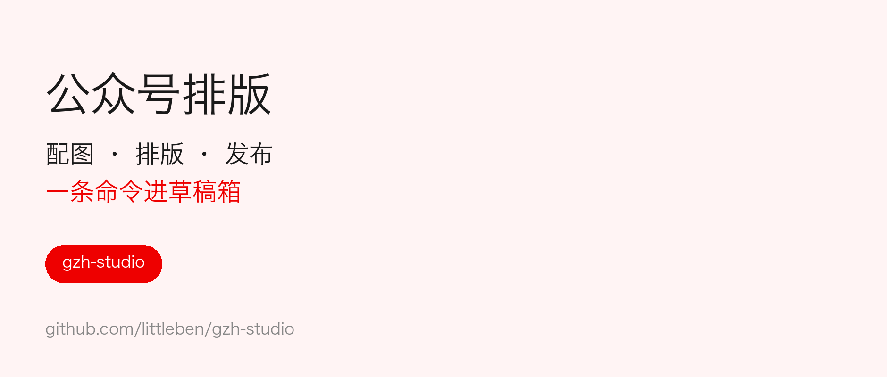
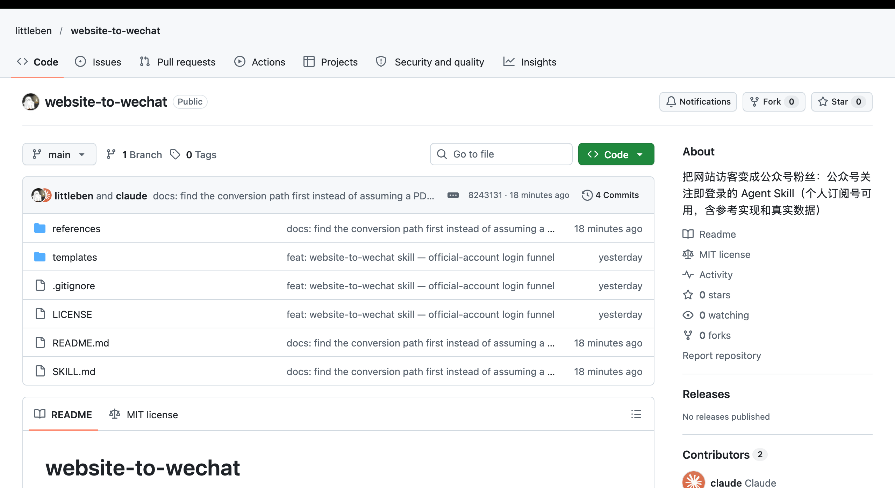

> [!INTRO] 排版不是堆组件，而是让==该强调的地方==被看见。

这是一篇示例文章，用来展示 gzh-studio 的每一种组件。换一个主题，同一份 Markdown 会排出完全不同的气质。

> [!TOC] 真实配图 | 分散的组件 | 一键进草稿箱

## 一、配图先找真实截图

能截后台、截产品、截数据的地方，都用真实截图，不用自己画的示意图。截图要裁到正文说的那一块，手机上才看得清。



## 二、组件分散着用

核心概念用==底色高亮==标一次，关键句用 ++下划线++，最重要的判断用**加粗**。

1. 一屏最多一个容器组件
2. 两个卡片之间至少隔一句话
3. 列表项不要每条都加粗

> [!QUOTE] 每种组件都可以用，但不要连着堆在一起。

几种常用组件的用量，可以参考这张表：

| 组件 | 适合放什么 | 建议用量 |
|---|---|---|
| 数据卡片 | 两三个关键数字 | 1～2 处 |
| 时间线 | 迭代、经历 | 1 处 |
| 提示条 | 给照做的人的提醒 | 1～2 处 |

> [!NOTE] 灰色旁注适合放口径、来源这类补充说明，存在感很低。

## 三、一条命令进草稿箱

> [!DATA] 6 套 | 主题
> 12 种 | 组件
> 1 条 | 命令

渲染、校验、压图、上传封面、建草稿，一条命令做完：

```bash
python3 scripts/publish.py article.md --ssh myserver
```

整个流程是这样的：

> [!TIMELINE] 写 | Markdown + 组件标记
> 预览 | 手机宽度截图检查密度
> 发布 | 进草稿箱，人工预览后群发

草稿进箱以后，还要在手机上预览一遍。

> [!TIP] 改稿重发会新建一份草稿，记得删掉旧的。

> [!WARN] 本机 IP 不在公众号白名单里会报 40164，用 --ssh 走白名单服务器。

> 让该强调的地方被看见

> [!END]

**关于作者**

示例作者，公众号写作者
- 这里写两三行简介
